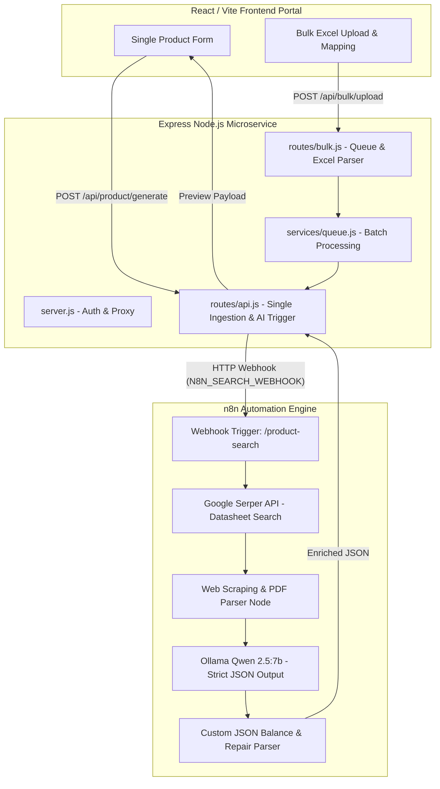

# Product Ingestion & AI Enrichment Microservice (Add_products_Microservice)

An enterprise-grade product catalog ingestion and SEO enrichment microservice designed for multi-vendor e-commerce platforms. 

This microservice provides **Single Product Creation**, **Bulk Excel Ingestion**, and an **Autonomous n8n + Local LLM Pipeline** that scrapes technical specifications and generates conversion-focused Amazon-standard product listings.

---

## 🏗️ Architecture Overview



---

## ⚡ Key Highlights & Core Capabilities

### 1. Dual Ingestion Modes
- **Single Product Enrichment (`routes/api.js`):** Vendors input minimal details (Product Name, Brand, EAN/Barcode). The service calls the background AI engine to retrieve technical datasheets and enrich the catalog in real-time.
- **Bulk Upload & Pipeline (`routes/bulk.js`, `services/queue.js`):** Vendors upload `.xlsx` files with hundreds of products. A concurrency-controlled queue batches items and passes them through the AI enrichment pipeline without exceeding rate limits.

### 2. Autonomous Research & Scraping (n8n Pipeline)
- **Serper Google Search:** Queries official datasheets, user manuals, and technical specification sheets.
- **Domain Whitelisting & Filtering:** Automatically filters out social networks, user forums, and low-signal domains.
- **Resilient Web Page & PDF Extraction:** Distinguishes between binary PDFs and HTML pages, sanitizes script/style tags, and detects anti-bot signals (Cloudflare, 403 Forbidden) with automated fallbacks to search snippets.

### 3. Local LLM Inference (Zero API Costs)
- Uses **Ollama (Qwen 2.5: 7B)** running locally, ensuring zero recurring token costs and zero third-party data leakage.
- Generates:
  - **SEO Title:** 70–170 characters formatted for e-commerce search algorithms.
  - **Product Overview:** 80–100 words covering use-cases and build quality.
  - **5 Key Feature Bullets:** Highlighting technical benefits.
  - **Technical Specifications:** Clean key-value pairs (10–15 specs).

### 4. Fault-Tolerant JSON Parsing & Auto-Repair
- Custom regex and bracket-balancing parser inside n8n Code Nodes that fixes common LLM output anomalies (unescaped quotes, broken braces, markdown fences) ensuring downstream databases never crash.

---

## 📂 Project Structure

```text
Add_products_Microservice/
├── backend/
│   ├── config/
│   │   └── db.js                        # MongoDB Database Connection
│   ├── models/                          # Database Schemas (VendorRecord, Manufacturer, PanelUser)
│   ├── routes/
│   │   ├── api.js                       # Single product ingestion & n8n AI webhook caller
│   │   └── bulk.js                      # Bulk Excel processing & queue dispatcher
│   ├── services/
│   │   ├── excelService.js              # Excel parsing & column normalizer
│   │   └── queue.js                     # In-memory batch & rate-limit queue
│   ├── server.js                        # Microservice entrypoint & Auth middleware
│   ├── package.json
│   └── .env.example                     # Environment configuration template
├── frontend/
│   ├── src/
│   │   ├── components/                  # Single & Bulk Upload steps (BulkImportPage, ImageUploadStep, etc.)
│   │   ├── services/                    # API clients (api.js, bulkApi.js)
│   │   ├── App.jsx
│   │   └── main.jsx
│   ├── package.json
│   └── vite.config.js
└── n8n-workflow/
    └── Communets_Auto_Upload.json       # Exported n8n Workflow Blueprint
```

---

## 🚀 Setup & Installation

### 1. Backend Setup
```bash
cd Add_products_Microservice/backend
npm install
cp .env.example .env
# Fill in your MONGODB_URI and N8N_SEARCH_WEBHOOK in .env
npm start
```

### 2. Frontend Setup
```bash
cd Add_products_Microservice/frontend
npm install
npm run dev
```

### 3. Import n8n Workflow
1. Open your n8n workspace.
2. Click **Import from File** and select `n8n-workflow/Communets_Auto_Upload.json`.
3. Configure your Serper API Header Auth and Ollama credentials.
4. Activate the workflow and copy the Production Webhook URL into `backend/.env` under `N8N_SEARCH_WEBHOOK`.